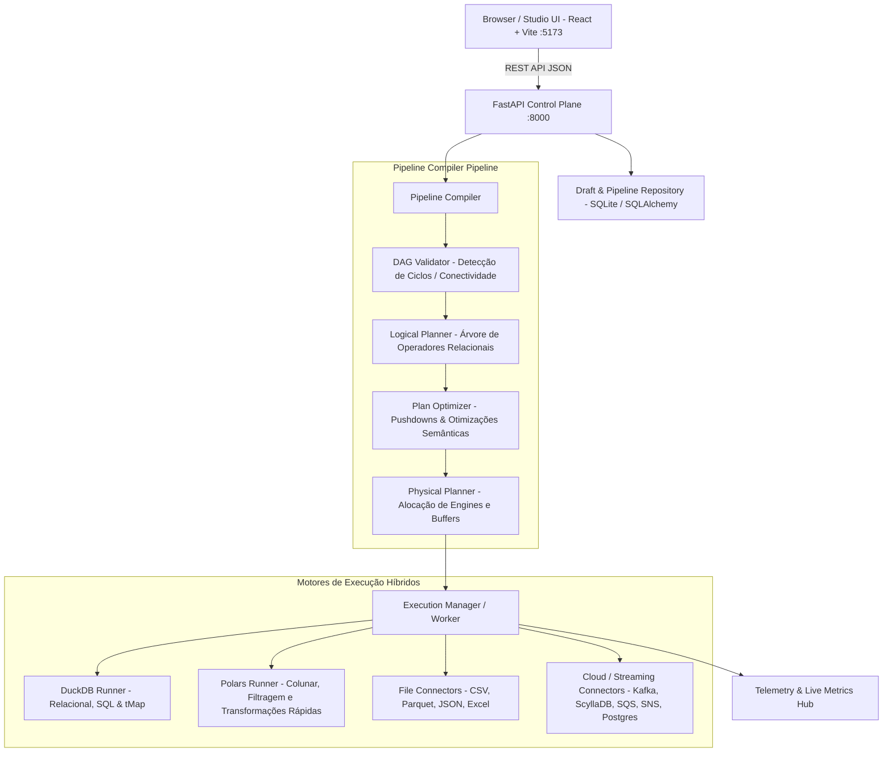

# 🚀 RocketDataForge — Documentação Técnica Completa

**Versão da Aplicação:** `1.2.0`  
**Arquitetura:** Clean Architecture / Domain-Driven Design (DDD) com Compilador de Planos Lógico/Físico e Motores Vetorizados Híbridos (DuckDB + Polars).

---

## 1. Visão Geral da Aplicação

O **RocketDataForge** é um **Studio Moderno de Engenharia e Integração de Dados (ETL/ELT)** projetado para construir, compilar, validar, debugar e executar pipelines analíticos de alta performance e baixa latência.

Inspirado nas capacidades analíticas de ferramentas legadas de integração (como Talend Open Studio / Data Integration), o RocketDataForge moderniza totalmente o paradigma através de:
- **Canvas Visual Reativo**: Construção visual de DAGs (Directed Acyclic Graphs) em tempo real via React Flow.
- **Motor de Execução Híbrido Vetorizado**: DuckDB (para processamento relacional SQL OLAP, joins complexos e tMap) e Polars (para streaming colunar, leitura e escrita rápida de arquivos).
- **Mapeador Visual Avançado (`Data Mapper` / `tMap`)**: Múltiplos lookups, controle de match models (*all*, *first*, *unique*), variáveis intermediárias sequenciais, roteamento multi-saída e captura automática de rejeições (*inner join rejects* e *output filter rejects*).
- **Compilador Multinível de Pipelines**: Validação de DAG acíclica, planejamento lógico formal, otimização baseada em regras (*Filter Pushdown*, *Projection Pushdown*) e geração de plano físico com seleção dinâmica de motores.
- **Observabilidade e Telemetria Integradas**: Métricas em tempo real por nó (linhas de entrada, linhas de saída, duração, taxa de transferência) e instrumentação via OpenTelemetry.

---

## 2. Stack Tecnológica e Versões

### 2.1 Backend (Control Plane & Execution Engine)
| Tecnologia / Biblioteca | Versão Mínima | Finalidade no Sistema |
| :--- | :--- | :--- |
| **Python** | `>= 3.10` (Recomendado: `3.11` ou `3.12`) | Runtime principal do backend |
| **FastAPI** | `>= 0.115.0` | Framework web assíncrono para a API REST |
| **Uvicorn** | `>= 0.30.0` | Servidor ASGI de alta performance |
| **Pydantic** | `>= 2.8.0` | Validação estrita de contratos de dados (DTOs) |
| **DuckDB** | `>= 1.1.0` | Motor relacional SQL OLAP em memória para consultas, tMap e joins |
| **Polars** | `>= 1.8.0` | DataFrame engine colunar e vetorizado em Rust |
| **SQLAlchemy** | `>= 2.0.30` | ORM e persistência de metadados (Workspaces, Pipelines, Projetos, Execuções) |
| **PyYAML** | `>= 6.0.1` | Serialização e exportação de pipelines canônicos |
| **OpenTelemetry (API & SDK)** | `>= 1.26.0` | Tracing e instrumentação distribuída |
| **JSONSchema** | `>= 4.20.0` | Validação de schemas de componentes e parâmetros |
| **Pytest** | `>= 8.0.0` | Suite de testes unitários, integração e golden tests |

### 2.2 Frontend (Design Studio Web UI)
| Tecnologia / Biblioteca | Versão | Finalidade no Sistema |
| :--- | :--- | :--- |
| **Node.js** | `>= 18.0.0` (LTS recomendada: `20.x` ou `22.x`) | Runtime JavaScript para build e tooling |
| **React** | `^18.3.1` | Biblioteca de interfaces reativas |
| **TypeScript** | `^5.7.3` | Tipagem estática rigorosa para UI e contratos |
| **Vite** | `^6.1.0` | Bundler e servidor de desenvolvimento ultra-rápido |
| **React Flow** | `^11.11.4` | Engine de nós, portas e arestas para o Canvas de DAGs |
| **Lucide React** | `^0.475.0` | Biblioteca de ícones modernos para componentes e ferramentas |
| **Vanilla CSS** | Modern CSS3 | Sistema de design escuro com glassmorphism |

---

## 3. Arquitetura do Sistema



### 3.1 Camadas do Código (`src/core/`)
- **`domain/`**: Entidades puras, agregados e regras de negócio (`PipelineDraft`, `Node`, `Edge`, `Execution`, `Connection`, catálogo de definições).
- **`application/`**: Casos de uso e compilador (`GraphValidator`, `LogicalPlanner`, `PlanOptimizer`, `PhysicalPlanner`).
- **`infrastructure/`**:
  - **`engines/`**: Executores de baixo nível (`DuckDBRunner`, `PolarsRunner`).
  - **`connectors/`**: Conectores de E/S (`LocalFileConnector`, `PostgresConnector`, `ScyllaConnector`, `KafkaConnector`, `AwsMessagingConnector`).
  - **`execution/`**: Orquestrador de tarefas e worker de execução (`ExecutionWorker`, `ExecutionManager`).
  - **`web/`**: Endpoints REST FastAPI (`routers/pipelines.py`, `workspaces.py`, `executions.py`, etc.).
  - **`persistence/`**: Modelos SQLAlchemy e repositórios.

---

## 4. Catálogo de Componentes Suportados (17 Componentes)

O RocketDataForge possui um catálogo completo de componentes com portas tipadas e contratos imutáveis:

### 4.1 Origens (Sources)
1. **`core.file.source` / `core.file.source.csv`**: Leitura de arquivos locais (CSV, Parquet, JSON, Excel) com inferência automática de schema.
2. **`core.database.source`**: Leitura de bancos relacionais (PostgreSQL, MySQL, SQL Server) via queries SQL com pushdown.
3. **`connector.db.duckdb`**: Leitura analítica direta de alta performance via DuckDB sobre arquivos ou banco `.duckdb`.
4. **`connector.nosql.scylla`**: Leitura de bancos NoSQL distribuídos (ScyllaDB / Apache Cassandra) via queries CQL.
5. **`connector.streaming.kafka`**: Consumidor de eventos em tempo real a partir de tópicos Apache Kafka.
6. **`connector.cloud.aws_sqs`**: Consumidor de filas AWS SQS (Standard e FIFO) com extração de payload JSON.

### 4.2 Transformações (Transforms)
7. **`core.tmap` (Data Mapper)**: Transformador visual avançado estilo Talend. Suporta:
   - Múltiplos fluxos de entrada (1 *Main* + *N* *Lookups*).
   - *Match Models*: `All matches`, `First match`, `Unique match` (último).
   - Tipos de junção: `Left Outer Join` e `Inner Join`.
   - Variáveis intermediárias (`Var`) calculadas em cascata.
   - Expressões SQL/Java transpiladas dinamicamente para DuckDB.
   - Suporte completo a nomes de colunas com espaços (`row1.Working URL`).
   - Múltiplos fluxos de saída com filtros e captura de rejeições (`catch_inner_join_reject` e `catch_output_reject`).
8. **`core.filter`**: Filtro de registros por expressões lógicas booleanas com porta de rejeição opcional.
9. **`core.select`**: Projeção, reordenação e renomeação de colunas do dataset.
10. **`core.join`**: Junção relacional binária dedicada (*Inner*, *Left*, *Right*, *Full*).

### 4.3 Destinos (Targets / Sinks)
11. **`core.file.target`**: Gravação de arquivos locais (Parquet colunar, CSV delimitado, JSON) em modos *append* ou *replace*.
12. **`core.database.target`**: Gravação em bancos relacionais com ações de tabela (*drop_create*, *create_if_not_exists*, *truncate*) e ações de dados (*insert*, *update*, *upsert*, *delete*).
13. **`connector.db.duckdb.output`**: Gravação em tabelas de bancos de dados locais DuckDB.
14. **`connector.nosql.scylla.output`**: Gravação em lote (*batch*) de alta vazão no ScyllaDB/Cassandra.
15. **`connector.streaming.kafka.output`**: Produtor de eventos JSON para tópicos Apache Kafka.
16. **`connector.cloud.aws_sqs.output`**: Enfileiramento de mensagens em lote para filas AWS SQS.
17. **`connector.cloud.aws_sns.output`**: Publicador de mensagens e eventos para tópicos AWS SNS (Pub/Sub).

---

## 5. Como Instalar e Configurar a Aplicação

### 5.1 Pré-requisitos
- **Git** instalado no sistema.
- **Python 3.10+** (recomendado Python 3.11 ou 3.12).
- **Node.js 18+** e gerenciador **npm** (recomendado Node 20 LTS).

### 5.2 Passo a Passo de Instalação

#### 1. Clonar o Repositório
```bash
git clone <URL_DO_REPOSITORIO> rocketdataforge
cd rocketdataforge
```

#### 2. Configurar o Backend (Python)
```bash
# Criação do ambiente virtual
python -m venv .venv

# Ativação do ambiente virtual:
# Windows (PowerShell):
.venv\Scripts\Activate.ps1
# Windows (CMD):
.venv\Scripts\activate.bat
# Linux / macOS:
source .venv/bin/activate

# Atualização do pip e instalação das dependências
pip install --upgrade pip
pip install -r requirements.txt
```

#### 3. Configurar o Frontend (Node.js / React)
```bash
cd ui
npm install
cd ..
```

---

## 6. Como Rodar a Aplicação

### 6.1 Método Rápido (Launcher Automático no Windows)
Na raiz do projeto, execute o script batch:
```cmd
start_rocketdataforge.bat
```
ou
```cmd
start.bat
```
O launcher irá:
1. Detectar o `.venv` local.
2. Iniciar o backend FastAPI em `http://localhost:8000`.
3. Iniciar o frontend Vite em `http://localhost:5173`.
4. Abrir automaticamente a interface no navegador padrão.

---

### 6.2 Método Manual (Terminais Separados - Windows / Linux / macOS)

#### Terminal 1 — Backend (FastAPI na porta 8000):
```bash
# Estando na raiz do projeto e com o ambiente virtual ativado:
set PYTHONPATH=.
python -m src.core.infrastructure.web.main
```
*(No Linux/macOS utilize `export PYTHONPATH=. && python -m src.core.infrastructure.web.main`)*

#### Terminal 2 — Frontend (Vite na porta 5173):
```bash
cd ui
npm run dev
```

---

## 7. URLs Principais do Sistema

| Serviço | URL | Descrição |
| :--- | :--- | :--- |
| **Studio Web UI** | `http://localhost:5173` | Canvas visual, TMap Modal, catálogo de nós e telemetria |
| **API REST Swagger Docs** | `http://localhost:8000/docs` | Documentação OpenAPI interativa de todos os endpoints |
| **Health Check** | `http://localhost:8000/api/v1/health` | Status de integridade do servidor |

---

## 8. Execução da Suite de Testes

Para rodar todos os testes unitários, testes de compilador e testes de integração:
```bash
# Com o .venv ativado na raiz:
pytest -v
```
*(Resultado esperado: 97 testes aprovados)*

---

## 9. Estrutura de Diretórios do Projeto

```text
rocketdataforge/
├── data/                               # Diretório padrão para bancos DuckDB e artefatos locais
├── docs/                               # Documentações técnicas, diagramas C4 e manuais
├── src/                                # Código-fonte da aplicação (Clean Architecture)
│   └── core/
│       ├── application/                # Casos de uso, compilador, validadores e otimizadores
│       │   ├── compiler/               # DAGValidator, LogicalPlanner, PhysicalPlanner, Rules
│       │   └── pipelines/              # Exportadores e conversores canônicos
│       ├── domain/                     # Entidades puras, Agregados, Enums e Catálogo
│       │   ├── catalog/                # Definições canônicas dos 17 componentes
│       │   ├── execution/              # Agregado Execution, TaskRun, FSM de estados
│       │   ├── metadata/               # Conexões, Credenciais, Schemas
│       │   ├── pipeline/               # PipelineDraft, Node, Edge, Port
│       │   └── shared/                 # Tipos primitivos, PortId, SemanticVersion, Exceptions
│       └── infrastructure/             # Adaptadores de tecnologia, drivers e persistência
│           ├── connectors/             # File, Postgres, Scylla, Kafka, AWS SQS/SNS
│           ├── engines/                # DuckDBRunner, PolarsRunner
│           ├── execution/              # ExecutionWorker, ExecutionManager
│           ├── metadata/               # SchemaInferer (CSV, Parquet, JSON, DuckDB)
│           ├── persistence/            # SQLite/SQLAlchemy Models e Repositories
│           ├── security/               # SecretResolver, Redaction
│           ├── telemetry/              # TelemetryService, OpenTelemetry
│           └── web/                    # FastAPI App, Routers, DTOs, Dependencies
├── tests/                              # Suite de testes com pytest
│   ├── e2e/                            # Testes ponta a ponta
│   ├── golden/                         # Testes de regressão do compilador
│   └── unit/                           # Testes unitários de domínios, engines e connectors
├── ui/                                 # Aplicação Frontend (React + TypeScript + Vite)
│   ├── src/
│   │   ├── features/designer/          # Canvas, TMapModal, PropertyPanel, Nodes, Edges
│   │   ├── store/                      # Zustand / JobStore e Gerenciamento de Estado
│   │   └── App.tsx                     # Ponto de entrada do Studio UI
│   ├── package.json                    # Dependências da interface
│   └── vite.config.ts                  # Configuração do Vite
├── requirements.txt                    # Dependências Python
├── start_rocketdataforge.bat           # Launcher automatizado Windows
└── README.md                           # Visão geral rápida
```
