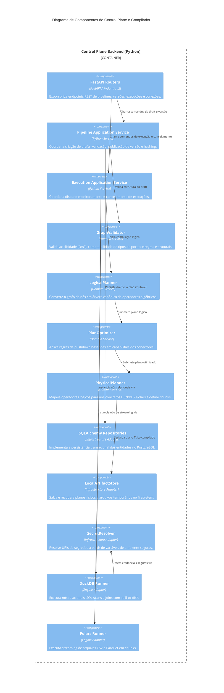

# Arquitetura C4: Diagrama de Componentes (Nível 3)

**Documento:** `docs/c4/component.md`  
**Versão:** 1.0.0  
**Status:** Aprovado  

---

## 1. Visão Geral dos Componentes Internos

O diagrama detalha a estrutura interna modular do backend Python, ilustrando o fluxo de compilação, o isolamento do domínio e os adaptadores de infraestrutura.

---

## 2. Diagrama C4 Component (Mermaid)

---

## 3. Fluxo de Dados e Interações

1. **Recepção de Requisição:** O `FastAPI Routers` recebe a solicitação HTTP e valida o payload contra os DTOs Pydantic v2.
2. **Ciclo de Compilação:** O `Pipeline Application Service` utiliza os serviços de domínio (`GraphValidator` $\rightarrow$ `LogicalPlanner` $\rightarrow$ `PlanOptimizer` $\rightarrow$ `PhysicalPlanner`). Nenhuma dessas classes de domínio conhece o banco de dados relacional ou detalhes do framework web.
3. **Persistência Limpa:** As portas de repositório são invocadas para salvar as entidades de domínio utilizando `SQLAlchemy Repositories` de forma transacional.
4. **Execução de Dados:** O `Execution Service` orquestra a chamada aos runners de engine (`DuckDB Runner` e `Polars Runner`), processando dados em blocos e garantindo que o `SecretResolver` atue como o único canal de resolução de credenciais.
