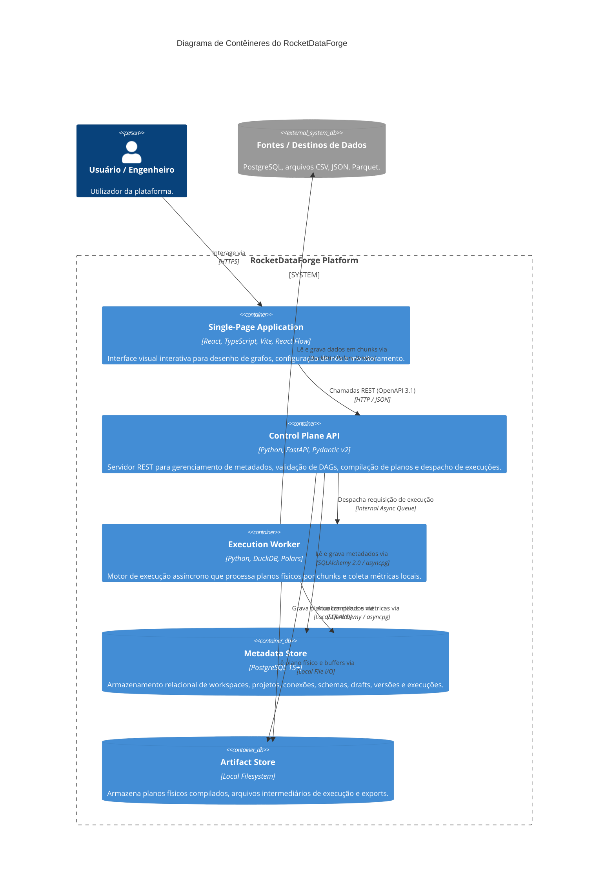

# Arquitetura C4: Diagrama de Contêineres (Nível 2)

**Documento:** `docs/c4/container.md`  
**Versão:** 1.0.0  
**Status:** Aprovado  

---

## 1. Visão Geral de Contêineres

O RocketDataForge é estruturado como um **Modular Monolith** ([ADR-001](file:///c:/Natura/PYTHON/RocketDataForge/03_Architecture_Decision_Records_ADR-001-020.md#L9)) composto por contêineres de controle, execução e armazenamento:

---

## 2. Diagrama C4 Container (Mermaid)

---

## 3. Responsabilidades e Fronteiras de Comunicação

### 3.1 Single-Page Application (SPA)
- Executa no browser do cliente.
- Responsável unicamente pela renderização visual dos nós no canvas com React Flow e pela captura de inputs no painel de propriedades.
- Nunca contém lógica de negócios ou segredos de conexão.

### 3.2 Control Plane API
- Ponto central de validação e compilação do sistema.
- Recebe o grafo visual, valida a aciclicidade e portas, e executa a transformação em 4 estágios (`Logical`, `Optimized` e `Physical Plan`).
- Mantém o estado transacional de versões e execuções no PostgreSQL.

### 3.3 Execution Worker
- Processo de execução de dados isolado.
- Instancia os adaptadores do DuckDB e Polars com base no plano físico gerado pelo Control Plane.
- Itera sobre os dados em blocos configuráveis (chunks), coletando métricas a cada etapa e respondendo a comandos de cancelamento cooperativo.
