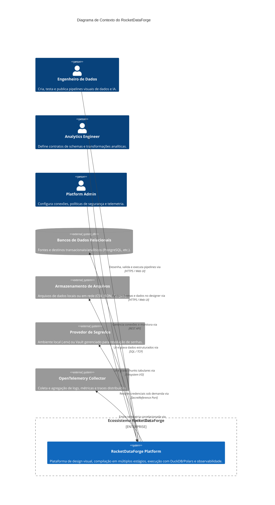

# Arquitetura C4: Diagrama de Contexto (Nível 1)

**Documento:** `docs/c4/context.md`  
**Versão:** 1.0.0  
**Status:** Aprovado  

---

## 1. Visão Geral de Contexto

O **RocketDataForge** é uma plataforma visual e Python-native para engenharia de dados e IA. Ele permite a criação, validação, compilação, execução e observabilidade de fluxos de transformação de dados operando localmente no MVP e com arquitetura pronta para expansão remota.

---

## 2. Diagrama C4 Context (Mermaid)

---

## 3. Descrição dos Elementos

- **Engenheiro de Dados & Analytics Engineer:** Acessam a aplicação visualmente no browser para desenhar nós, conectar portas e inspecionar planos de execução.
- **RocketDataForge Platform:** Núcleo do sistema, responsável pelo gerenciamento de workspaces, drafts, validação de DAGs, compilação em estágios e execução local isolada.
- **Bancos e Arquivos Externos:** Sistemas que contêm os dados a serem processados. O acesso a eles respeita a semântica do motor selecionado (DuckDB/Polars).
- **Provedor de Segredos:** Abstração que impede que credenciais em texto puro entrem nos arquivos de pipeline.
- **OpenTelemetry Collector:** Destino para onde a telemetria é exportada para observabilidade em larga escala.
